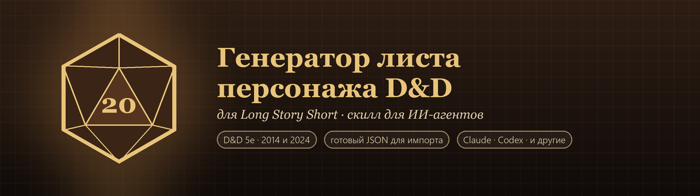

# Генератор листа персонажа D&D для Long Story Short (LSS)

Скилл для ИИ-агентов, который создаёт персонажа D&D 5e (ДнД 5e) и сразу собирает его лист для
[Long Story Short](https://longstoryshort.app). Описываешь героя своими словами, присылаешь анкету
игрока или картинку - агент задаёт пару вопросов и отдаёт готовый файл `.json`. Файл
импортируется в LSS и сразу работает: характеристики, навыки, спасброски, хиты, КД, оружие,
магические предметы с бонусами, счётчики умений, заклинания и портрет.

Скилл в открытом формате Agent Skills (папка с `SKILL.md`): его подхватывают Claude Code,
Claude.ai, Codex и другие агенты, которые понимают этот формат. Подойдёт и любой агент, которому
можно дать файлы и Python.

- Редакции D&D 2014 и 2024
- Заклинания из SRD сами находятся в LSS, в том числе по русским названиям
- Магические предметы раскладываются по листу: +1 к оружию, кольца и плащи защиты,
  предметы с настройкой, заряды
- Портрет персонажа встраивается в лист
- Каждый лист проверяется официальной JSON Schema LSS до того, как попадёт к тебе

## Установка

### Попроси своего агента

Если у агента есть терминал и интернет (Claude Code, Codex и подобные), просто дай ему ссылку
на репозиторий:

> Установи себе скилл из https://github.com/Dezodemius/dnd-lss-character-generator - инструкция
> в README, раздел «Установка агентом».

Агент скачает архив из последнего релиза, распакует его в свою папку скиллов и проверит, что
всё работает. После этого начни новую сессию (или перезапусти агента), чтобы он увидел скилл.
Так же обновляется скилл до новой версии.

### Скачай архив

Архив со скиллом лежит в каждом [релизе](https://github.com/Dezodemius/dnd-lss-character-generator/releases)
в двух одинаковых вариантах: внутри zip с папкой `lss-character/`.

- [lss-character.zip](https://github.com/Dezodemius/dnd-lss-character-generator/releases/latest/download/lss-character.zip) - для Claude Code, Codex и других агентов
- [lss-character.skill](https://github.com/Dezodemius/dnd-lss-character-generator/releases/latest/download/lss-character.skill) - для загрузки в Claude.ai

| Где | Как установить |
|---|---|
| Claude Code | распаковать в `~/.claude/skills/` (Windows: `%USERPROFILE%\.claude\skills\`) |
| Codex | распаковать в `~/.codex/skills/` (Windows: `%USERPROFILE%\.codex\skills\`) |
| Claude.ai | Settings -> Capabilities -> Skills -> Upload skill, выбрать `lss-character.skill`; нужно включённое выполнение кода. Сам агент в Claude.ai скилл себе поставить не может |
| Другой агент с поддержкой Agent Skills | распаковать в его папку скиллов |
| Любой агент с файлами и Python | дать ему архив и написать: «Распакуй, прочитай `lss-character/SKILL.md` и действуй по нему» |

То же из терминала (пример для Claude Code; для Codex замени `.claude` на `.codex`):

```bash
curl -L -o /tmp/lss-character.zip https://github.com/Dezodemius/dnd-lss-character-generator/releases/latest/download/lss-character.zip
unzip -o /tmp/lss-character.zip -d ~/.claude/skills/
```

```powershell
Invoke-WebRequest https://github.com/Dezodemius/dnd-lss-character-generator/releases/latest/download/lss-character.zip -OutFile "$env:TEMP\lss-character.zip"
Expand-Archive "$env:TEMP\lss-character.zip" -DestinationPath "$env:USERPROFILE\.claude\skills" -Force
```

После распаковки должна получиться папка `lss-character/` с файлом `SKILL.md` внутри.
Нужен Python 3.8+; желательно `pip install jsonschema pillow` (проверка схемой и портрет).

### Установка агентом

Инструкция для ИИ-агента, которого попросили установить этот скилл:

1. Определи свою папку скиллов: Claude Code - `~/.claude/skills/`, Codex - `~/.codex/skills/`,
   другой агент - та папка, откуда он читает скиллы в формате Agent Skills. Не знаешь, где она, -
   спроси пользователя.
2. Скачай https://github.com/Dezodemius/dnd-lss-character-generator/releases/latest/download/lss-character.zip
   и распакуй в эту папку. Должен появиться файл `<папка скиллов>/lss-character/SKILL.md`.
   Если папка `lss-character` уже была, замени её целиком: это обновление.
   Если релиза нет или скачать не вышло, склонируй репозиторий и скопируй из него папку
   `lss-character/`.
3. Выполни `pip install jsonschema pillow`. Если не получается (нет сети или прав), это не
   страшно: скилл работает и без них, просто с предупреждениями.
4. Проверь: `python <папка скиллов>/lss-character/scripts/lss.py spells --edition 2014 --search fire`
   должен вывести список заклинаний.
5. Скажи пользователю, что скилл установлен, и попроси начать новую сессию, чтобы скилл подхватился.

## Как пользоваться

Просто попроси агента, например:

- «Сделай лист для LSS: тифлинг-колдун 3 уровня, бывший цирковой акробат»
- «Сгенерируй лист персонажа по анкете» + текст анкеты + картинка
- «Перенеси моего паладина 5 уровня в Long Story Short» + описание или текст старого листа

Агент вернёт `<имя>.lss.json` и черновик `<имя>.draft.json`. Лист загружается в LSS через
импорт персонажа из файла .json. Черновик сохрани: на новом уровне попроси агента поправить его
и пересобрать лист.

## Частые вопросы

### Как создать персонажа в Long Story Short с помощью нейросети?

Установи скилл в своего агента (см. «Установка») и опиши персонажа: раса, класс, уровень,
характер, история. Если чего-то не хватает, агент спросит или предложит вариант сам. На выходе -
файл, который импортируется в LSS.

### Как импортировать персонажа D&D в LSS из JSON?

LSS принимает персонажа файлом .json в своём формате: обёртка документа и поле `data`, в котором
весь лист лежит JSON-строкой. Скилл собирает именно такой файл и проверяет его официальной схемой
LSS, так что его можно сразу загружать через импорт.

### Как перенести персонажа с dnd.su, из PDF или с бумажного листа в Long Story Short?

Скопируй текст листа (или опиши персонажа) и попроси агента перенести его в LSS. Он разложит
характеристики, навыки, оружие, умения и заклинания по полям LSS.

### Как сделать лист персонажа по анкете игрока?

Для мастеров: пришли агенту анкету как есть. Ответы про страхи, ценности, тайны и долги станут
характером, привязанностями и предысторией, а механику агент подберёт под образ и перечислит,
что решил сам. Личные контакты из анкеты в лист не попадают.

### Работает ли с D&D 2024?

Да. Агент спросит редакцию; по умолчанию 2014. Заклинания ищутся в SRD нужной редакции.

### Почему какое-то заклинание не появилось на листе?

LSS сам находит только заклинания из SRD. Заклинания из других книг (Hex, Booming Blade, всё из
Таши и Ксанатара) появятся, когда игрок добавит их в свой Гримуар. Агент заранее предупреждает
о таких заклинаниях.

### Портрет не отобразился, что делать?

LSS обычно хранит аватар у себя на сервере, а скилл встраивает картинку прямо в файл. Если она
не показалась, загрузи картинку кнопкой аватара на листе - на остальное это не влияет.

### Нужна ли платная подписка?

Скиллу нужен агент, который умеет работать с файлами и запускать Python. Подойдёт любой такой
агент на любом тарифе, где это доступно.

## Разработка

```
lss-character/          сам скилл - то, что попадает в архив
  SKILL.md              инструкция для агента
  scripts/lss.py        сборка черновика в лист и проверка
  reference/            схема LSS, справочники заклинаний SRD, формат черновика
  templates/            пример черновика и готовые листы
tests/fixtures/         черновики для смоук-тестов (*.ok - должны собраться, *.bad - отклониться)
tools/check.py          смоук-тесты
tools/package.py        сборка dist/lss-character.skill и dist/lss-character.zip
```

```bash
pip install jsonschema pillow
python tools/check.py
python tools/package.py
```

Чтобы агент на своей машине пользовался скиллом прямо из репозитория, свяжи папку ссылкой,
а не копией (Windows, для Codex - `.codex` вместо `.claude`):

```powershell
New-Item -ItemType Junction -Path "$env:USERPROFILE\.claude\skills\lss-character" -Target "<путь к репозиторию>\lss-character"
```

Схему и справочники LSS обновляет `python lss-character/scripts/lss.py refresh`.

### Релиз

Тег из четырёх чисел (`0.1.0.0`) запускает `.github/workflows/release.yml`: смоук-тесты,
сборка архива и релиз на GitHub с `lss-character.skill`, `lss-character.zip` и их sha256.
Теги другого вида релиз не запускают.

```bash
git tag 0.1.0.0
git push origin 0.1.0.0
```

## English

**D&D 5e character sheet generator for Long Story Short (LSS).** An agent skill in the open
Agent Skills format (`SKILL.md`) for Claude Code, Claude.ai, Codex and other AI agents. Describe
a character or paste a player questionnaire and a portrait, and the agent produces a `.json`
file ready to import into [Long Story Short](https://longstoryshort.app): ability scores, skills,
HP, AC, weapons, magic items with bonuses, resource counters, SRD spells and the portrait.
Supports D&D 2014 and 2024 rules; every sheet is validated against the official LSS JSON Schema.

Install: ask your agent "Install the skill from
https://github.com/Dezodemius/dnd-lss-character-generator, see the README section «Установка
агентом»", or download
[lss-character.zip](https://github.com/Dezodemius/dnd-lss-character-generator/releases/latest/download/lss-character.zip)
and unpack it into your agent's skills folder (`~/.claude/skills/`, `~/.codex/skills/`, ...), or
upload [lss-character.skill](https://github.com/Dezodemius/dnd-lss-character-generator/releases/latest/download/lss-character.skill)
in Claude.ai. Requires Python 3.8+, ideally with `jsonschema` and `pillow`.
The skill's instructions are in Russian, but agents follow them in any language.

## Источники

Схема листа и справочники заклинаний SRD в `lss-character/reference/` взяты из открытой
документации для разработчиков Long Story Short:
https://longstoryshort.app/doc/developers/characters/. Проект не связан с командой LSS.
Материалы SRD 5.1 / 5.2 распространяются по лицензии CC-BY-4.0 (Wizards of the Coast).
